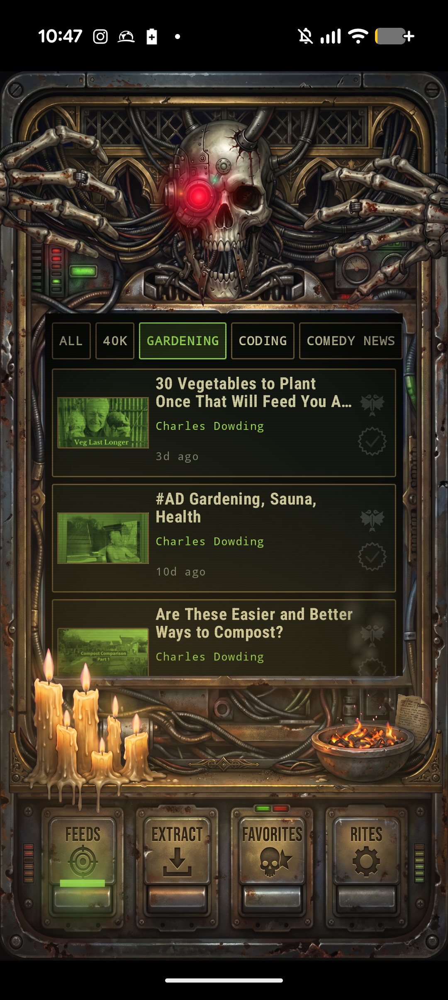
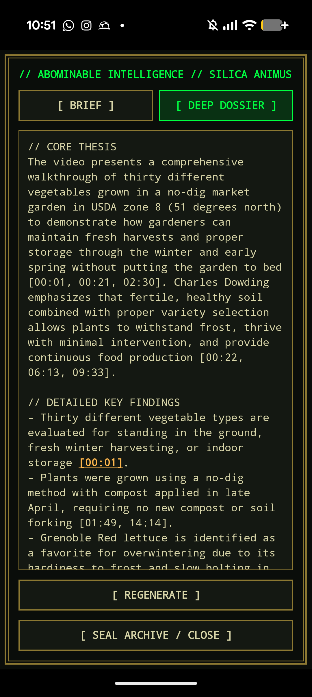
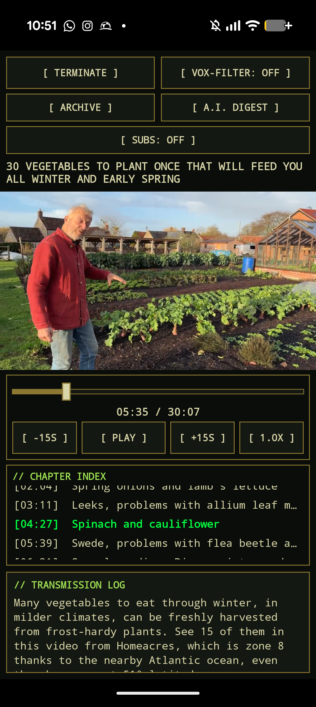
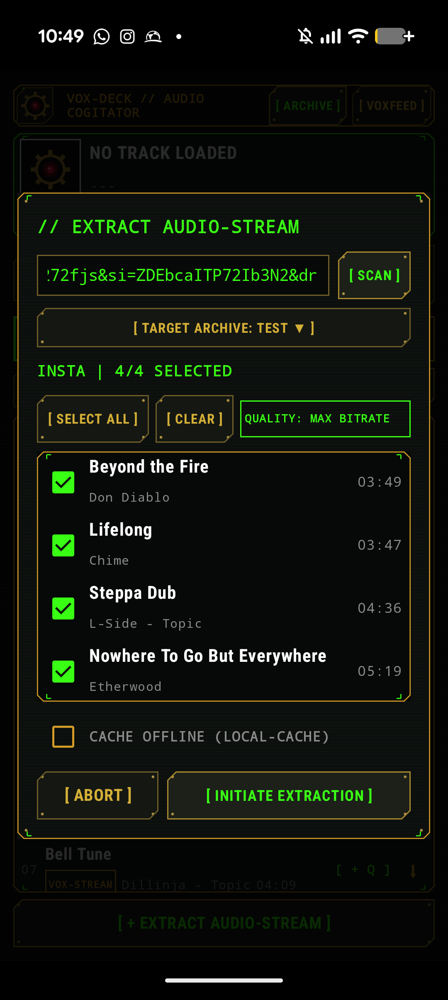
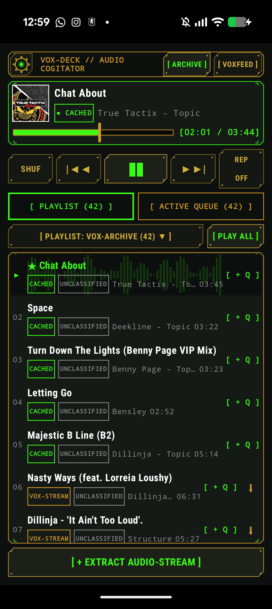

# VoxPlayer - Video Feed & Audio Deck

**Watch and listen on your terms—without the algorithm.**

YouTube is engineered to keep you scrolling through Shorts, rage-bait recommendations, and endless autoplay loops. **VoxPlayer** strips all of that away, turning YouTube into a calm, local-first RSS feed, on-demand AI briefing tool, and offline music deck in a clean, high-contrast dark interface.

## Why VoxPlayer?
* **Zero Algorithmic Traps:** No home feed, no Shorts, no suggested-video sidebar, and no Google account login required. You only see new uploads from the exact channels you subscribe to.
* **Triage Before You Watch (On-Demand AI Scans):** Bring your own free Google Gemini API key and scan any video at **Brief**, **Standard**, or **Deep** depth before deciding if it is worth 20 minutes of your time.
* **Viewable Chapters & Key-Point Jumping:** Browse clean video chapters at a glance or tap key points directly inside the AI scan breakdown to cut straight to the exact moment of interest—skipping sponsor reads and filler.
* **Audio Deck:** Extract and cache maximum-bitrate audio streams locally for distraction-free background listening, complete with playlists, favourites, genre tags, and real-time PCM equalizer bars. Videos support the same custom playlists, with channel and playlist dropdown filters.
* **100% Local-First:** Your subscriptions, cached summaries, and offline audio tracks stay on your device via Room and Android MediaStore.

## Screenshots
| RSS Feed | AI Video Scan | Chapters & Key Jumps | Audio Extraction | Audio Deck |
| :---: | :---: | :---: | :---: | :---: |
|  |  |  |  |  |

## Setup: Free Gemini API Key
AI video scans use your own free Google Gemini API key (stored locally on your device):
1. Go to **[Google AI Studio API Keys](https://aistudio.google.com/api-keys)** and sign in with a Google account.
2. Click **Create API key** and choose or create a Google Cloud project (no credit card or billing setup is required for the free tier).
3. Copy the generated key, open **VoxPlayer > Settings**, paste it into the **Gemini API Key** field, and save.

## Download & Install
Grab the latest signed APK from the **[Releases](https://github.com/thelillypond/VoxPlayer/releases/latest)** page and install it on Android 8.0+.